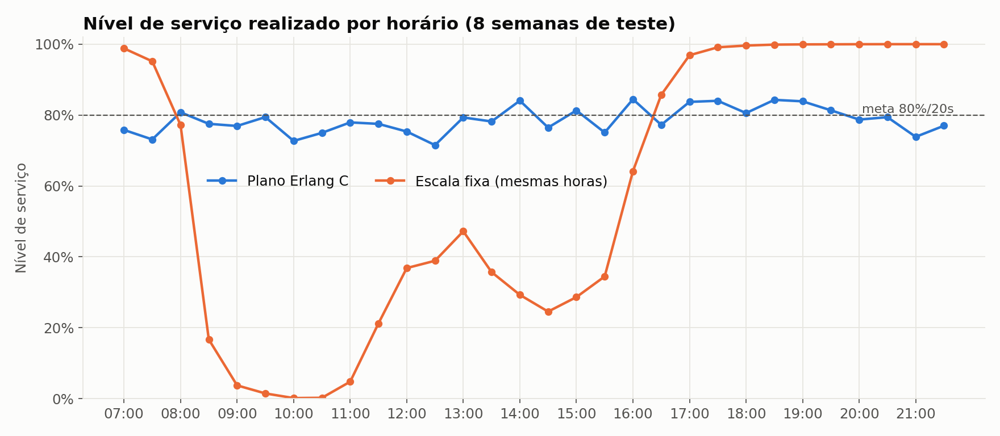
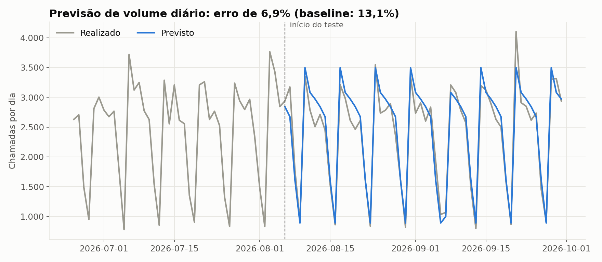
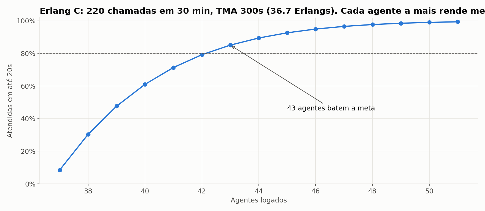
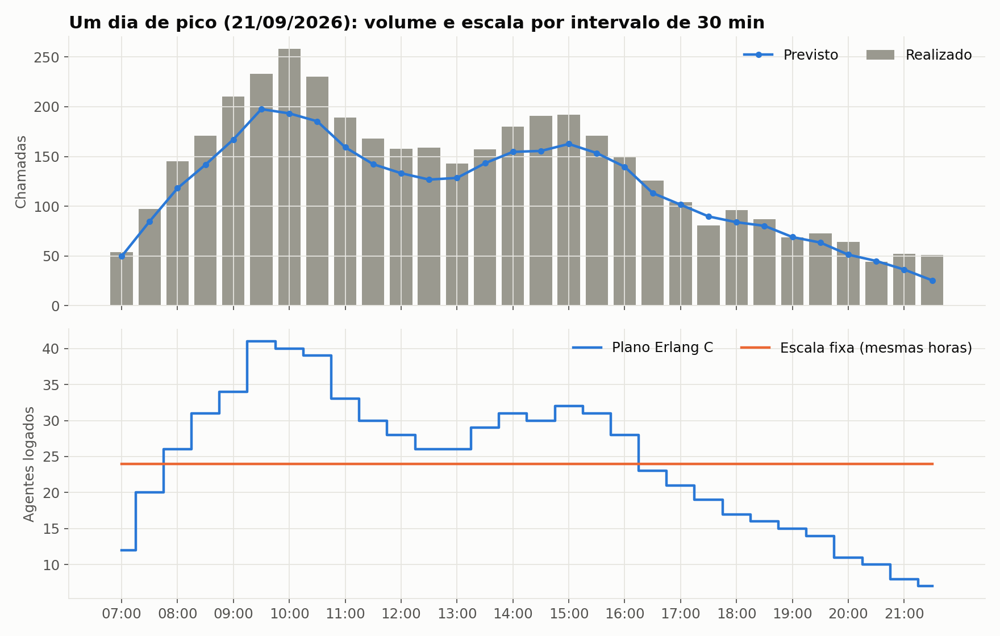

# Dimensionamento de Call Center com Forecast + Erlang C

> **Com as mesmas horas de agente, só redistribuindo a escala pelo dia, o nível de serviço
> sai de 42% para 78%** e os intervalos com fila "explodindo" caem de 27,6% para 2%.

Projeto ponta a ponta de **Workforce Management (WFM)**: prevê o volume de chamadas por
intervalo de 30 minutos, calcula quantos agentes são necessários com a fórmula de
**Erlang C** e mede o impacto contra o que realmente aconteceu.



---

## O problema

Toda central de atendimento vive o mesmo dilema a cada 30 minutos:

- **Gente de menos:** fila, abandono, cliente irritado, meta de nível de serviço estourada.
- **Gente demais:** agente ocioso e custo jogado fora.

Escalar "no feeling" ou com o mesmo número de pessoas o dia todo erra para os dois lados
ao mesmo tempo: sobra gente à noite e falta no pico da manhã.

## A solução

```
Histórico (30 min)  ->  Forecast diário (Holt-Winters)  ->  Curva intradiária
                                                              |
Resultado real  <-  Avaliação dos cenários  <-  Erlang C + ocupação máx. + shrinkage
```

1. **Dados:** 21 meses de histórico por intervalo de 30 min (07h às 22h), com
   sazonalidade semanal e intradiária, efeito de início de mês, feriados e crescimento.
2. **Forecast:** volume diário com Holt-Winters (tendência amortecida + sazonalidade
   semanal). Feriados são limpos do treino e ganham um fator próprio. O volume do dia é
   distribuído pelos intervalos pela curva intradiária de cada dia da semana.
3. **Erlang C:** para cada intervalo, o menor número de agentes que garante
   **80% das chamadas atendidas em até 20s**, sem passar de **85% de ocupação**.
   Depois aplica **30% de shrinkage** (pausas, treinamento, absenteísmo).
4. **Validação:** a fórmula é conferida contra uma **simulação de eventos discretos**
   de uma fila M/M/c. Os dois têm que bater, e batem.
5. **Avaliação honesta:** os planos são feitos só com a previsão e avaliados contra o
   volume e TMA reais das 8 semanas de teste.

## Resultados (8 semanas de teste)

**Previsão**

| Modelo | Erro diário (WAPE) | Erro por intervalo (WAPE) |
|---|---|---|
| Holt-Winters + curva intradiária | **6,9%** | **11,3%** |
| Baseline (mesmo dia da semana passada) | 13,1% | 18,4% |

**Escala**

| Indicador | Plano Erlang C | Escala fixa (mesmas horas) |
|---|---|---|
| Nível de serviço (ponderado por chamadas) | **78,2%** | 42,0% |
| Intervalos que bateram a meta | **68,3%** | 52,4% |
| Intervalos em colapso (agentes ≤ tráfego) | **2,0%** | 27,6% |
| Espera média nos intervalos estáveis | **74 s** | 384 s |
| Horas-agente logadas | 14.985 | 15.015 |

**Leitura:** o custo é praticamente o mesmo. O que muda é *onde* as horas estão.

**Achado extra:** dimensionando exatamente para 80%, o realizado fica em ~78%, porque o
erro de previsão cai metade para cada lado. Com `MARGEM_SEGURANCA = 0.05` no
`config.py` (dimensionar para previsão +5%), o nível de serviço vai para **84,3%** com
cerca de **+4% de horas**. É o tipo de trade-off que a gestão precisa enxergar.

**Erlang C x simulação**

| Chamadas/30min | TMA | Agentes | NS Erlang C | NS simulado |
|---|---|---|---|---|
| 150 | 300 s | 28 | 62,6% | 63,7% |
| 150 | 300 s | 30 | 82,1% | 82,9% |
| 300 | 280 s | 53 | 82,6% | 83,0% |

<p float="left">
  
  
</p>



---

## Como rodar

### 1. O que baixar

- **Python 3.10 ou mais novo:** https://www.python.org/downloads/
  (no Windows, marque **"Add Python to PATH"** na instalação)
- **VS Code** (opcional, para editar): https://code.visualstudio.com/
- **Power BI Desktop** (opcional, só Windows, grátis na Microsoft Store) para o painel
- **Git** (opcional, para subir no GitHub): https://git-scm.com/downloads

### 2. Instalar e executar

Abra o terminal na pasta do projeto:

```bash
# cria um ambiente isolado
python -m venv .venv

# ativa
# Windows (PowerShell):
.venv\Scripts\Activate.ps1
# Linux / macOS:
source .venv/bin/activate

# instala as bibliotecas
pip install -r requirements.txt

# roda tudo (leva poucos segundos)
python main.py

# testes do Erlang C
python -m pytest
```

> Se o PowerShell bloquear a ativação, rode uma vez:
> `Set-ExecutionPolicy -Scope CurrentUser RemoteSigned`

### 3. O que sai

| Arquivo | O que é |
|---|---|
| `data/historico_chamadas.csv` | histórico bruto (entrada) |
| `outputs/fato_intervalos.csv` | previsão, agentes, NS e ocupação por intervalo, nos dois cenários |
| `outputs/fato_diario.csv` | volume real x previsto por dia |
| `outputs/resumo_cenarios.csv` | tabela comparativa dos cenários |
| `outputs/metricas_forecast.csv` | WAPE e bias do modelo e do baseline |
| `outputs/validacao_simulacao.csv` | Erlang C x simulação |
| `outputs/graficos/*.png` | gráficos prontos para README e LinkedIn |

Os CSVs saem no padrão brasileiro (`;` e vírgula decimal) e abrem direto no Excel e no
Power BI. O passo a passo do painel está em [`powerbi/GUIA_POWERBI.md`](powerbi/GUIA_POWERBI.md).

### 4. Brincar com os parâmetros

Tudo fica em `src/config.py`: meta de NS, tempo meta, ocupação máxima, shrinkage,
margem de segurança, custo por hora. Mude e rode `python main.py` de novo.

## Estrutura

```
├── main.py                 # roda o pipeline inteiro
├── requirements.txt
├── src/
│   ├── config.py           # todos os parâmetros
│   ├── gerar_dados.py      # histórico sintético realista
│   ├── forecast.py         # Holt-Winters + curva intradiária + baseline
│   ├── erlang.py           # Erlang B/C, NS, ASA, agentes necessários
│   ├── simulacao.py        # simulação M/M/c para validar o Erlang C
│   ├── dimensionamento.py  # plano Erlang C x escala fixa
│   └── graficos.py
├── tests/test_erlang.py
├── powerbi/GUIA_POWERBI.md # modelo, medidas DAX e layout do painel
└── outputs/                # gerado pelo main.py
```

## Limitações e próximos passos

- Os dados são **sintéticos**. O pipeline aceita dados reais com as colunas
  `data_hora, chamadas, tma_seg`: é só substituir o CSV em `data/`.
- Erlang C ignora **abandono** (assume paciência infinita), por isso tende a
  superdimensionar um pouco. Próximo passo: **Erlang A**.
- Gerar **turnos reais** (escalas de 6h/8h com pausas) a partir da necessidade por
  intervalo, com otimização linear (PuLP).
- Testar modelos de forecast com variáveis externas (feriados, campanhas, faturamento).

---

Feito por **Leonardo Alves Braz** · Engenharia da Computação, UFC
